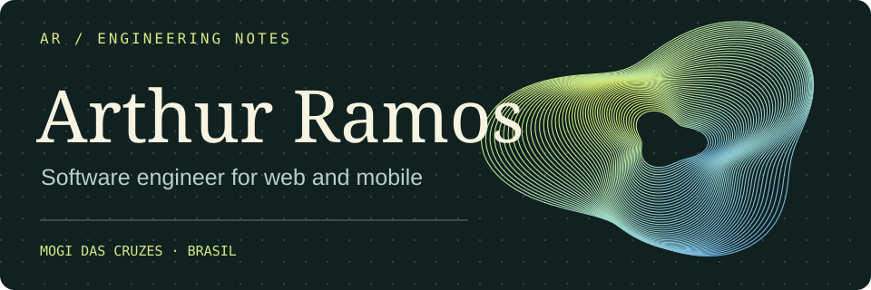
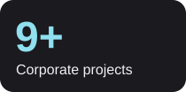
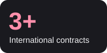
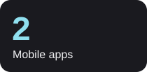
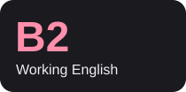
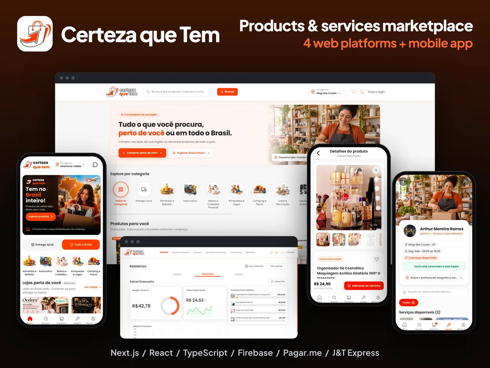
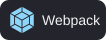

<a href="https://www.arthur-moreira-ramos.com.br/home">Portfolio</a>　·　<a href="https://www.linkedin.com/in/arthur-moreira-ramos">LinkedIn</a>　·　<a href="mailto:arthurmoreiraramos550sp@gmail.com">Email</a>

   

## Selected work

|  |  |
| :--- | :--- |
| [Certeza que Tem ↗](https://www.arthur-moreira-ramos.com.br/projetos) | [Queimando o Bacon ↗](https://www.arthur-moreira-ramos.com.br/projetos) |

|  |  |
| :--- | :--- |
| [Elementa ↗](https://www.playelementa.com) | [Eleven Labs ↗](https://project-eleven-lab.vercel.app/conversational-ai/dashboard) |

|  |  |
| :--- | :--- |
| [Dra. Solange ↗](https://adv-solange-pied.vercel.app/) | [Portfolio ↗](https://www.arthur-moreira-ramos.com.br/home) |

## Stack

**Frontend & design**

         

**Backend & data**

      

**Cloud & delivery**

     

## GitHub

